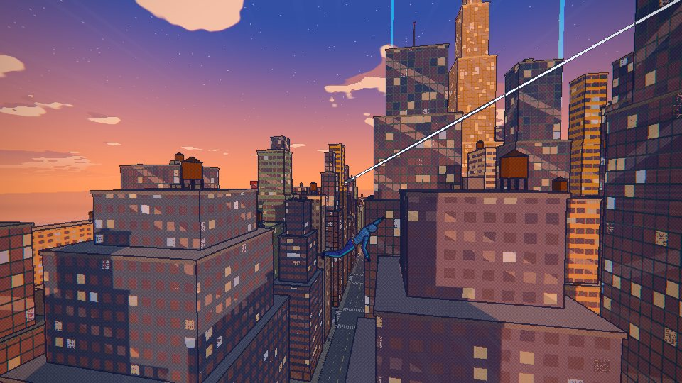
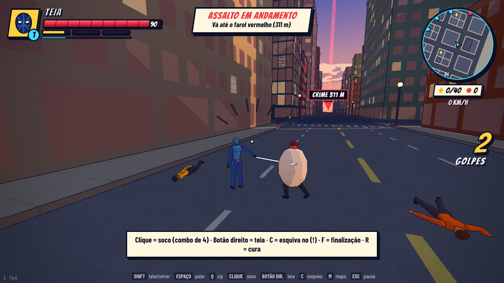
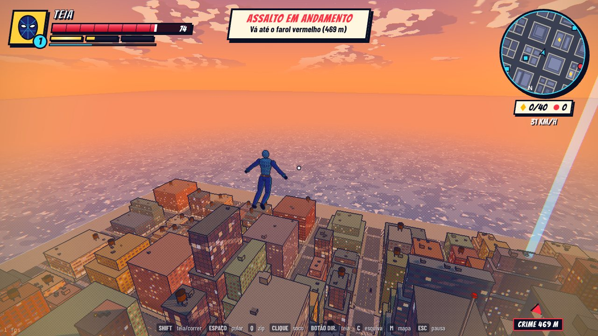

# TEIA URBANA

Jogo 3D de mundo aberto de super-herói aracnídeo, inspirado na jogabilidade de *Marvel's Spider-Man*, mas com
personagem, cidade e identidade visual **originais** (sem marcas ou personagens da Marvel). Você é **TEIA**, uma
heroína/herói de traje índigo com teia ciano que protege a ilha de **Nova Aurora**.

**Estilo visual:** animação em quadrinhos ("cel shading"), com contorno de tinta, retícula de pontos nas sombras,
linhas de velocidade, aberração cromática em alta velocidade e onomatopeias na tela (THWIP!, POW!, KRAK!). O
céu tem ciclo de dia e noite: o jogo começa no fim de tarde e, à noite, as janelas da cidade acendem.

HTML + JavaScript puro (ES modules) com [three.js](https://threejs.org) r170 incluído em `vendor/`. Sem build, sem
`node_modules` e sem arquivos de arte externos: prédios, personagens, sons e música são gerados por código.

## Como rodar

**Windows:** dois cliques em `iniciar.bat` (dentro da pasta `TeiaUrbana-Web`). Ele sobe um servidor local e abre
`http://localhost:8080/`. Usa Node.js ou Python se existirem; senão, o PowerShell que já vem no Windows.
**Deixe a janela preta aberta enquanto joga.**

**Linux/macOS:** `./iniciar.sh` · **Manual:** `node servidor.mjs` (ou `python -m http.server 8080`) e abra
`http://localhost:8080/`.

> Abrir o `index.html` direto (`file://`) não funciona: o navegador bloqueia ES modules fora de um servidor.

Recomendado: Chrome, Edge ou Firefox atualizados, com aceleração por hardware ligada. Em notebooks mais simples,
use **ESC → OPÇÕES → Qualidade: Baixa** (o próprio jogo sugere isso se perceber que está lento). Com internet, a
fonte de quadrinhos (Bangers) é baixada do Google Fonts; sem internet, cai para Impact.

## Controles

| Teclado / mouse | Controle (Xbox/PS) | Ação |
|---|---|---|
| W A S D | analógico esquerdo | Mover |
| Mouse | analógico direito | Câmera |
| Espaço | A / ✕ | Pular · durante o balanço: salto com impulso |
| **Shift** (segurar, no ar) | RT / LT | **Balançar na teia** (soltar = largar a teia) |
| Shift (no chão) | RT | Correr; correndo contra uma parede, escala |
| Q ou botão do meio | LB | **Zip** até a borda mirada (losango ciano) · Espaço ao chegar = **lançamento** |
| Clique esquerdo | X / ▢ | Soco (combo de 4 golpes; o 4º arremessa) |
| Clique direito | Y / △ | Atirar teia (prende bandidos; 3 teias = preso) |
| C | B / ◯ | Esquiva · no aviso **!** = esquiva perfeita (câmera lenta) |
| F | RB | Finalização (gasta 1 barra de FOCO) |
| R | ↓ | Cura (gasta 1 barra de FOCO) |
| E | ↑ | Começar um desafio (no farol azul) |
| M / Tab | Select | Mapa da cidade |
| T | — | Avançar 3 horas no relógio do dia |
| N | — | Liga/desliga o som |
| Esc / P | Start | Pausa (estatísticas, controles, opções) |

## O que tem na cidade

- **Balanço com física de pêndulo:** a teia gruda nos prédios à frente e dos lados da rua; dá para emendar
  balanços segurando Shift, ganhar altura com Espaço, mergulhar em queda livre e escalar qualquer parede.
- **Crimes aleatórios** (sirene + farol colorido no céu):
  - *Assalto* (vermelho): grupo de bandidos — brigões, atiradores (mira laser) e brutamontes (bloqueiam socos,
    precisam de teia ou finalização).
  - *Carro em fuga* (roxo): alcance o carro e acerte 6 teias nele; depois, derrote os ocupantes.
  - *Civil em perigo* (laranja): alguém pendurado num prédio — chegue antes do tempo acabar.
- **3 desafios de anéis** (faróis azuis): corrida aérea contra o relógio, com medalha e recorde.
- **40 Cristais de Aurora** escondidos nos telhados (um deles no topo da Torre Aurora).
- **XP e níveis:** cada nível aumenta a vida; níveis ímpares deixam os golpes mais fortes; no nível 4 ganha uma
  barra extra de FOCO. O progresso fica salvo no navegador (botão NOVO JOGO apaga).
- **Vida na cidade:** ~100 carros nas faixas, ~300 pedestres nas calçadas, parque, caixas d'água, postes que
  acendem à noite e a **Torre Aurora** (288 m) no centro.

## Estrutura

| Arquivo | O que faz |
|---|---|
| `js/main.js` | Monta tudo, laço principal, menus, câmera lenta, tutorial |
| `js/cidade.js` | Cidade procedural (semente fixa), shader de janelas, colisores e raycast |
| `js/ambiente.js` | Céu com nuvens em dois tons, ciclo dia/noite, sol com sombras, mar |
| `js/pos.js` | Pós-processamento de quadrinhos (contorno, retícula, velocidade) |
| `js/jogador.js` | Física e estados do herói: chão, ar, balanço, parede, zip, combate |
| `js/modelo.js` / `js/heroi.js` | Bonecos articulados e poses animadas por código; traje do herói |
| `js/inimigos.js` | IA dos bandidos (fichas de ataque, aviso de perigo, teia, nocaute) |
| `js/missoes.js` | Crimes, perseguição, resgate, desafios, cristais, XP e salvamento |
| `js/trafego.js` | Carros e pedestres instanciados |
| `js/hud.js` | Barras, minimapa giratório, mapa, marcadores e banners |
| `js/audio.js` | Efeitos e trilha sintetizados com WebAudio |

## Testes

Precisam do Playwright (`npm i -g playwright`) e rodam o jogo num Chromium sem janela:

- `node tests/fisica.mjs` — simula 30 s de balanço em várias rotas (tempo em cada estado, velocidade, nº de
  balanços) e resolve cada tipo de missão do começo ao fim.
- `node tests/capturas.mjs [pasta]` — roteiro com balanço, zip, escalada, combate, noite e vista aérea, salvando
  capturas de tela.

Com `?teste=1` na URL o jogo pula o menu e expõe `window.jogo` (inclusive `jogo.avancar(segundos)` para
simular sem renderizar). `?hora=21` começa à noite.
